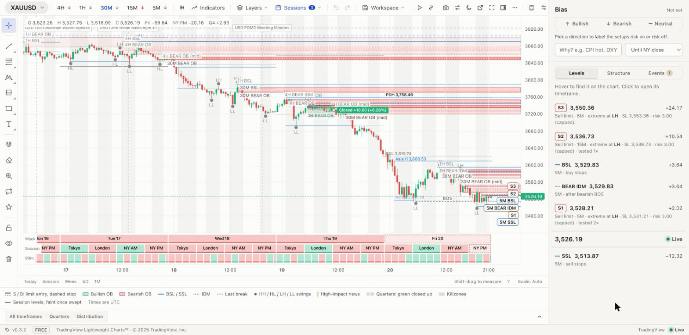

<div align="center">

# Wednesday

**Smart Money Concepts screener for XAUUSD.**<br>
Order blocks, liquidity and inducement across 4H → 5M, with ranked limit setups and Telegram alerts.



</div>

> [!WARNING]
> **Not financial advice. Every risk is yours.** Wednesday is an analysis tool: it never places
> orders, and its levels, setups, alerts and briefs are software output, not advice. Trading
> leveraged products can lose more than you deposit, and every decision and loss is your own
> responsibility. By using Wednesday you accept the [disclaimer and risk agreement](DISCLAIMER.md);
> the app asks you to accept it on first start.

## Features

- **Scans every minute**: 1-minute bars become 4H, 1H, 30M, 15M and 5M candles, scanned from the highest timeframe down, on closed candles only.
- **Nearest levels** above and below price: order blocks (extreme and mid), BSL / SSL with equal highs and lows, and inducement.
- **Ranked limit setups**: entry on the order block's body, stop on the opposite edge capped at 3.00, extreme first, then nearest. Each one is pinned on the chart under the same tag.
- **Your bias steers the list**: bullish, bearish or neutral, set by hand. Setups get RISK ON / RISK OFF labels.
- **News brief**: Claude or OpenAI reads the news pages you pick and suggests a bias you can apply with one click.
- **News risk time**: high-impact US releases on the chart, a countdown card an hour before, and how gold moved after past releases of the same event.
- **Charts**: drawing tools, indicators (EMA, SMA, Bollinger Bands, RSI), candles, hollow candles or Heikin Ashi, snapshots, bar replay and chart settings.
- **Sessions and reference levels**: killzones, the Asia range, previous day / week / month high and low, and the day, week, midnight and quarter opens, in New York time.
- **Quarterly theory pane**: every weekday, session and 90-minute quarter as a block, coloured by direction or by quarter, with how often each one closed green.
- **1, 2 or 4 charts** full screen with linked crosshairs, and charts in their own windows for other monitors, saved as workspaces.
- **Journal**: import an MT5 history report for gain, drawdown and the growth curve, with the drawdown rebuilt from M1 prices.
- **Telegram alerts** when price trades into an order block.
- **Free data**: Yahoo Finance by default, or spot gold from TradingView, no account needed; history in SQLite or PostgreSQL, and M1 files (MT5, Dukascopy, HistData, CSV) imported for more.

## Why "Wednesday"

Quarterly theory splits time into four quarters: accumulation, manipulation, distribution,
then reversal or continuation. The third quarter, distribution, is where the true move of
the cycle usually happens, after the manipulation has taken the liquidity.

- **In the week**, that quarter is **Wednesday** (Monday accumulates, Tuesday manipulates,
  Thursday reverses or continues).
- **In the day**, it is the **New York** session (after Asia and London).

So Wednesday in New York is the third quarter of the third quarter: the window where the
real direction is most likely to show. It isn't always green. It is where a setup is most
likely to follow through, up or down. The quarterly pane under the chart draws those blocks,
and its stats count how often each one closed green or red, so you can check it on your own data.

## Quick start

1. Download `WednesdaySetup-<version>.exe` from the
   [latest release](https://github.com/mragungsetiaji/wednesday/releases/latest) and run it.
   No Python or Node needed. Windows may say "Windows protected your PC" because the
   installer isn't code signed: click **More info > Run anyway**.
2. Start **Wednesday** from the Start menu or the desktop.
3. It starts on free Yahoo Finance data (COMEX futures). For spot gold, open
   **Settings > Data source**, pick **TradingView** and save.
4. Upgrading? Run the new installer: your data and settings stay.

From source (macOS, Linux, Windows with uv and Node 20+):

```bash
make setup   # installs everything and builds the dashboard
make serve   # dashboard on http://127.0.0.1:8000
make demo    # the same on demo data
```

Everything else is in the [docs](docs/README.md).

## License

Free for personal use, including trading your own accounts. Not for sale: you may not sell
Wednesday or a modified copy, charge for access to it, or offer it or its signals as a paid
service. Licensed under the [PolyForm Noncommercial License 1.0.0](LICENSE) with an added
permission for personal trading; see [LICENSE](LICENSE) for the exact terms and
[DISCLAIMER.md](DISCLAIMER.md) for the risk agreement.

The charts are drawn with TradingView's [Lightweight Charts™](https://github.com/tradingview/lightweight-charts),
under the Apache License 2.0:

```
TradingView Lightweight Charts™
Copyright (с) 2025 TradingView, Inc. https://www.tradingview.com/
```

That notice and a link to <https://www.tradingview.com/> sit in the dashboard's status bar.
It and the other bundled packages keep their own licenses; see
[THIRD_PARTY_NOTICES.md](THIRD_PARTY_NOTICES.md). The notices ship with the installer.
