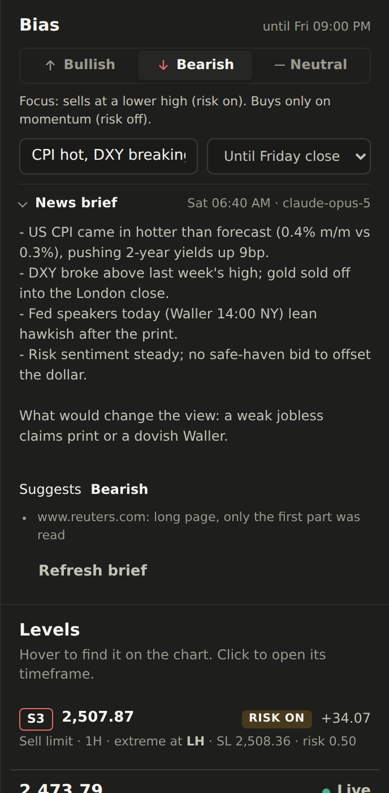

# Bias

Wednesday doesn't score the news. You read it and set
a **bias** by hand; the bias then labels the setups so you know where to focus.
Both directions stay on the list: momentum trades against the bias are still
there, just marked for a smaller risk.

## Setting the bias

At the top of the panel next to the chart. It starts folded to a line (the direction and when it
expires): click *Bias* to open it.

| Bias | Risk on (focus) | Risk off (still listed) |
| --- | --- | --- |
| **Bearish** | Sells, preferably at a **lower high** order block | Buys, on momentum |
| **Bullish** | Buys, preferably at a **higher low** order block | Sells, on momentum |
| **Neutral** | Nothing: every setup is marked **No trade** and Telegram alerts pause | |

- Add a short note on why (it shows in the pill on the full screen charts).
- Pick how long it holds: until the **New York close** (17:00 NY), until
  **Friday's close**, or **until changed**. Once it runs out, the panel says so and
  the labels go away until you set it again.
- The bias is saved in the database, so it survives restarts.

## What the bias changes

- **Labels** on the S / B setups in the ladder: `RISK ON`, `RISK OFF` or `NO TRADE`.
- **Order** on the favoured side: order blocks at a lower high (bearish) or higher
  low (bullish) come first, then the usual extreme-first, nearest-first order.
  The ladder still reads like the price axis, highest first.
- **Telegram alerts** end with the label, e.g. `RISK ON (with bearish bias)`. With
  a neutral bias they pause, unless *Alert with a neutral bias too* is ticked in
  Settings.
- The console output and `--json-out` carry the same labels.

Nothing is filtered out. The swing tags (`LH`, `HH`, `HL`, `LL`) are explained in
[detectors.md](detectors.md#swing-tag).
