# Dashboard

```bash
make serve          # the Rust server; or the Python one: make serve-py
```

Opens on http://127.0.0.1:8000. It refreshes every few seconds; the server
rescans once a minute. With the Python server (`make serve-py`), API docs live at `/api/docs`.

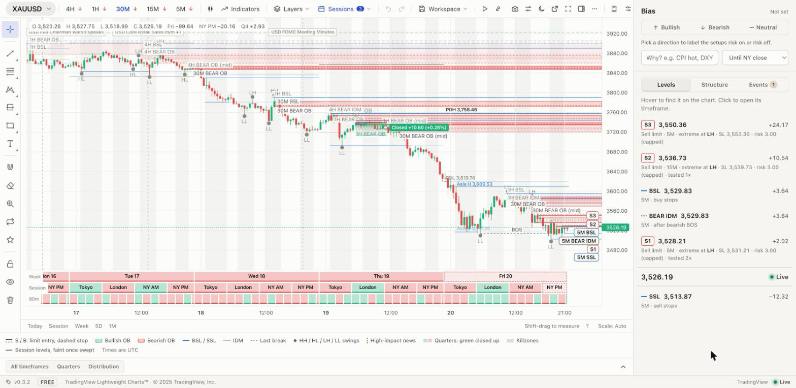

## Chart first

The browser tab follows the live feed tick by tick: the symbol, its price and the
change since the day's open, as in `XAUUSD 3,568.59 ▼ −0.42%` (it reads `Wednesday`
until the first price arrives). A chart in its own window keeps its own title.

The chart shows the selected timeframe's candles with everything the detectors
found on it:

- **Order blocks** as boxes; mid OBs are lighter than extreme OBs.
- **Liquidity** (BSL / SSL, EQH / EQL) and **inducement** as lines.
- **Higher-timeframe levels**, faded, so you see where a 5M setup sits inside the 1H picture.
- The **latest break of structure** (BOS / CHoCH) as a dashed segment.
- **Swing labels**: `HH` / `LH` above swing highs and `HL` / `LL` below swing
  lows, so the structure reads at a glance.
- **Recent sweeps** as markers on the candle that swept.

The timeframe tabs carry each timeframe's structure direction (↑ / ↓). Beside
them, the **Layers** menu switches the detectors (**Order blocks**, **Liquidity**,
**Inducement**) and the overlays (**Mid OBs**, **HTF**, **Swings**, **News**) on and
off. The chart carries no legend under it; the readout at its top left names what is
under the pointer.

The chart has no page header: its top bar starts with the market. Click the symbol
(`XAUUSD`) to pick another from the list in **Settings > Markets**. It starts with
**XAU** from two venues (gold, `FX:XAUUSD` from FXCM and `OANDA:XAUUSD`), **XAG**
(silver, `FX:XAGUSD`), **DXY** (`TVC:DXY`), **NQ** (Nasdaq 100, `OANDA:NAS100USD`),
**S&P** (`OANDA:SPX500USD`) and **DJI** (Dow Jones 30, `OANDA:US30USD`); the venue
beside each name tells the two golds apart. Picking one moves the
whole screener to it, as **Settings > Data source** does: the feed reconnects and the
scan, levels and alerts follow the new market after its first scan. The indices are
OANDA's CFDs, which trade nearly round the clock like gold. The same menu lists the
source, bar times, candles and last scan. **Journal** and **Settings** are the two
icons at the right end of the top bar; their pages keep a slim header with
**Chart**, **Journal** and **Settings** to come back.

The levels-pane button near the right end of the chart's top bar hides the right pane
(bias, levels, structure and events) so the chart takes the full width, and
shows it again. The dashboard remembers the choice in this browser.

The header price follows the [live price](data-sources.md#live-price): each tick
flashes green or red, and the arrow keeps the last direction.

### Moving around the chart

A bar under each chart (the main one and every full screen pane) holds:

- **Time range presets**: **Today** (the trading day, from 18:00 New York),
  **Session** (the current Tokyo, London, NY AM or NY PM window), **Week** (from
  Sunday 18:00 New York), **5D** (the last five trading days) and **1M**. They
  come from the same New York blocks as the [quarterly pane](#quarterly-theory-pane),
  so they land on the right candles whatever the feed clock. Older candles load
  when the range starts before the first one on the chart.
- **Scale**: **Price** (auto, the default), **Log**, or **% from session open**
  (the price axis in percent from the current session's open). **Lock range**
  keeps the price range the chart has now, so a spike, a new tick or a scan
  doesn't rescale it, until you unlock it. **Invert** flips the chart upside down,
  to check a bias the other way. **Reset** goes back to auto.
- **Snapshot** (the camera, or **Alt+S** to copy straight away): **Copy image**,
  **Save as PNG**, or **Attach to a journal trade**. See [Chart snapshots](#chart-snapshots).

**Shift-drag** on the chart measures a move: the price change, in % and in pips,
and how many bars and how long it spans. It goes away when you let go. A pip is
the symbol's usual size (0.1 on gold, 0.01 on yen pairs and silver).

When you scroll back and the live candle leaves the screen, a **Live** button
at the bottom right brings it back.

Each chart keeps its zoom and scroll while the app is open: go to Settings or
the Journal and back, or full screen and back, and the view is where you left
it. The view is kept per market: switch from XAU to DXY and back and each opens
where you left it, and a market you haven't viewed yet (or a new timeframe) starts
fitted to its candles, with the price scale fitting them again even after the price
axis was dragged.

The time left on the forming candle counts down beside the price label, for the
chart's timeframe.

### Keyboard shortcuts

During the NY open your hands stay on your trading platform; the chart takes keys too. None of them
fire while you're typing in a field, and **?** (or the **?** under a chart) lists
them.

| Keys | Action |
| --- | --- |
| `5`, `15`, `1h`, `4h` … then Enter | Switch the focused chart's timeframe (Esc cancels) |
| Alt+1 … Alt+6 | Focus chart 1 to 6 in full screen (it gets a thin outline; clicking a chart focuses it too) |
| Alt+R | Reset the zoom and scroll to the live candle |
| Alt+S | Copy a snapshot of the focused chart (saved as a file where copying isn't allowed) |
| Alt+G | Go to a date and time: "last Wednesday 09:30", "yesterday 8pm", "24 Sep 3:15pm", "2026-09-24 14:00" |
| Alt+H / Alt+T / Alt+B | Horizontal line / trendline / rectangle tool |
| F | Full screen on and off |
| ? | The shortcut list |
| Shift+drag | Measure a move |
| Enter | Finish a path |
| Esc | Cancel the tool or the selection; leave full screen |
| Delete | Delete the selected drawing |
| Ctrl+Z (⌘Z) | Undo a drawing change |
| Ctrl+Shift+Z, Ctrl+Y (⌘⇧Z) | Redo |
| Space | Play or pause, in replay |
| ← / → | Step back or forward one candle in replay (with Shift: one minute) |

Go to reads times in **New York** time by default, or on the **feed** clock (the
chart's own times); end the text with "NY" or "feed" to pick one. A New York time
goes through the server, which converts it with the feed clock's offset on that
date, so a date across a DST change still lands on the right candle. A weekday is
the latest one (today counts); "last" skips today. When the date is older than the
loaded candles, older ones load first.

### Chart snapshots

The camera under a chart makes a picture of it as it is on screen: candles, zones,
levels, quarters, news lines and your drawings, without the crosshair. A footer
names the symbol and timeframe, the time in New York and on the feed clock, and
carries TradingView's notice (Lightweight Charts™, © TradingView), which every
exported chart image keeps.

- **Copy image** puts it on the clipboard, to paste into a chat. Where the
  clipboard is refused (plain http on a LAN, or the desktop app's WebView2) it is
  saved as a file instead, and a message says so.
- **Save as PNG** downloads it; the desktop app asks where to save it.
- **Attach to a journal trade** shows the picture, lets you pick the journal and
  one of its trades (open trades first, then the newest), and adds it to that
  trade's note. See [the journal](journal.md#notes).

In full screen, **Snapshot layout** at the top does the same for every chart at
once, each where it sits in the grid with its timeframe on it, and one footer.

## Drawings

The chart's top bar holds, left to right: the market menu (the symbol, the markets it
can switch to, and its source, bar times, candles and last scan), the timeframes (an arrow shows each one's bias), the
chart type, **Indicators** (with the quarterly pane, QT), **Layers** (the detectors and
overlays: Mid OBs, HTF, Swings, News), **Sessions**, undo and redo, **Workspace**, bar replay (▶) and
the link button. At the right end: the camera (copy, save or attach a picture of
the chart), chart settings, the light / dark switch, the pop-out, full screen and
levels-pane buttons, **⋯** (follow the system's theme again, the keyboard
shortcuts), then **Journal** and **Settings**.

The chart type draws filled candles, hollow candles (up candles drawn as an
outline) or Heikin Ashi, on every chart and window. Heikin Ashi changes only the
bars on screen: the scan, the levels, the setups, the drawings and the positions
keep using the real candles. The light / dark switch overrides the system's theme
in every window until **⋯ > Theme: follow the system**.

**Indicators** adds an EMA (20 to start), an SMA (50), Bollinger Bands (20, two
standard deviations), an RSI (14, in a pane under the chart with lines at 70 and
30) or **QT**, the quarterly pane (see [Quarters](#quarters)). Adding one opens its
settings: the length, the Bollinger Bands' standard deviations, the line width and the
colour (greys from white to black, ten hues in six shades, or any colour through
**Custom…**); QT's settings colour its blocks by direction or by quarter. Under **On
the chart** each one can be hidden and shown again (the eye), opened again (the
gear) or removed. The readout over the chart shows their values under the pointer.
They are worked out on closed candles only, and every chart and window shows the same
ones.

**Chart settings** opens from the toolbar's gear or by right-clicking the chart
(**Settings…**; the same menu has **Reset chart view**, Alt+R). On **Symbol**, the
candles: **Body**, **Borders** and **Wick**, each switched on or off with its own up
and down colour and opacity, **Colour candles by the previous close** (a candle is
up when it closed above the candle before it, not above its own open), and the last
price line. On **Canvas**, the grid (both, horizontal, vertical or none), the
crosshair (free, or on the candle's close) and the space after the last candle.
Changes show at once and apply to every chart; **Cancel** (or Esc) puts back what
was there, **Ok** keeps them, and **Reset to the defaults** goes back to the theme's
colours. Right-clicking a drawing still opens its alert instead.

The column left of the chart holds the drawing tools in TradeCanvas's groups. A
button with a small triangle in its corner is a group: it draws with the tool last
picked in it, and hovering it (or clicking the triangle) opens the rest, in sections:

- **Lines**: trend line, ray, extended line, info line (change, bars and angle),
  trend angle; horizontal line, horizontal ray, vertical line, cross line; parallel,
  regression (fitted to the closes between its two points), disjoint and flat
  top/bottom channels.
- **Fibonacci**: retracement, extension, channel, time zones, speed resistance fan
  and arcs, circles, spiral, wedge; pitchforks (standard, Schiff, modified Schiff),
  Gann fan, box and square, pitchfan; cyclic lines, time cycles, sine line.
- **Patterns**: XABCD, ABCD, head and shoulders, cypher, three drives (with the
  legs' ratios), and Elliott waves: impulse, correction, triangle, double and triple
  combo.
- **Forecasting**: long and short positions, forecast, projection, bars pattern (the
  candles between two points, copied ahead); price range, date range, date and price
  range, and measure. Anchored VWAP and the fixed range volume profile are listed but
  greyed out: they need volume, which the feeds here don't send.
- **Shapes**: rectangle, rotated rectangle, circle, ellipse, triangle, polyline,
  curve, arc; brush and highlighter (press and drag); path.
- **Annotation**: text, price label, arrow, note, callout, flag mark, arrow mark,
  icon, signpost, balloon, and anchored text and note, which stay where they are on
  the screen while the chart scrolls.

A tool takes one click per point (a fib extension three, an XABCD five); the first
leg can also be pressed and dragged. A polyline or path ends with Enter or a click on
its last point. Notes, callouts and the like start with a word you change with **T**
in the drawing's toolbar.

Below them:

- **Magnet**: points snap to the open, high, low or close of the candle under the
  pointer when one is within 24 px, while placing a drawing or dragging a handle.
- **Eraser**: click a drawing to remove it (locked ones stay). It stays picked
  until you pick another tool or press Esc.
- **Zoom**: drag across the candles to show just those.
- **Stay in drawing mode**: the tool stays picked after each drawing, to draw
  several in a row.
- **Favorites**: shows a bar of your favorite tools over the chart. Right-click
  a tool, or click the star beside it in a group's menu, to add or remove it.
- **Lock all** (or unlock all), **hide all**, and **remove all** (locked drawings
  stay). Lock all and remove all are one undo step each.

- **Trendline**: click two points, or press and drag.
- **Horizontal line**: click a price; its price shows at the right edge.
- **Rectangle**: click two corners, or press and drag.
- **Path**: click each point; click the last point again, double-click or press
  Enter to finish (Esc drops it).
- **Text**: click where it goes, then type in the field that opens.
- **Long / short position**: click the entry. It starts with the stop 40 px away,
  the target at 2R and 20 candles wide; drag the handles on its left edge to set
  the entry, stop and target, and the one on the entry line's right end to set how
  long it runs. The stop and target stay on their own side of the entry. Hover or
  select the position to see the prices, the distance to each and the R:R.

  The position also follows price, live ticks included. Like a limit order, it
  fills on the first candle from its start that reaches the entry (until then
  the entry label says *waiting for entry*, and a box that ends unfilled fades).
  Once filled, the area from the entry to the current price is shaded green in
  profit and red in loss, with a label: **Open**, then **Target hit** or **Stop
  hit** at the first candle that reaches one, or **Closed** at the close where
  the box ends. On the fill candle itself only its close counts, and a candle
  reaching both levels counts as the stop. It works on the candles of the chart
  you are looking at, so a higher timeframe can resolve a close call differently.

Points snap to the candle under the pointer. With the cursor, click a drawing to
select it, drag it to move it, or drag a handle to reshape it; double-click a text
to edit it. A toolbar over the chart styles the selected drawing, each button with
its own small menu. The squares-and-plus button holds **templates**: **Save drawing
template as…** keeps the drawing's look (color, width, line style, text size and
label) under a name such as "H1 OB", a click on a name gives the selected drawing
that look, and **Apply the default template** puts back the plain style. Lines,
rectangles and texts each have their own list; templates are kept in the database,
so they stay across restarts and windows. The pencil sets the color; **T** sets a text's words and size,
or puts a label on a line, trendline, path or rectangle (such as "H1 OB", drawn in
the line's color over its right end); then the line width and solid, dashed or
dotted. **Lock** stops it being moved or deleted, **Delete** removes it (or the
Delete key), and **⋯** clones it, removes its label or resets its style. Drag the
dots at the toolbar's left end to move it out of the way; it stays there, and a
double-click on the dots puts it back at the top. On a horizontal line,
trendline or rectangle the bell sets a price alert (right-clicking the drawing opens
it too): see [Alerts on your drawings](alerts.md#alerts-on-your-drawings). A drawing
with an alert carries a small bell, filled while it is on and struck through once it
fired.

**Undo** and **Redo** in the top bar (Ctrl+Z, Ctrl+Shift+Z or Ctrl+Y; Cmd on a
Mac; in full screen and pop-out windows, in the tool row) step back through the last 100 changes; a drag counts as one. The eye hides
or shows every drawing, and Esc cancels a tool or the selection.

Drawings are anchored to time and price, not pixels, so one drawing shows on
every timeframe and in full screen: a position from 10:00 to 11:00 is 12 candles
wide on 5M, 4 on 15M and one on 1H. Time past the last candle runs at the
timeframe's length, and moving a drawing shifts it by whole candles of time, so
it keeps its duration across the daily break or a weekend. They are saved in the database per data
source and symbol (symbols differ in price, and sources can differ in clock), in the
`drawings` table.

## Risk-time news card

An hour before high-impact news (USD by default), a card appears in the bottom
right with the release, a countdown, the time in your zone and in New York, and
the forecast and previous figure, and how gold moved after past releases of it
(see [Past reactions](#past-reactions-to-a-release)). Releases at the same minute
(CPI m/m, core, y/y) share one card.

- **Last 30 minutes**: a light runs around the card's edge and the countdown turns
  amber. With reduced motion on, the edge turns solid amber instead.
- **Released**: the card stays for 10 minutes with how long ago it came out.
- **Close (×)**: during the first half hour it only snoozes until the 30-minute
  mark; after that it hides for that release. It also shows over the full
  screen charts.

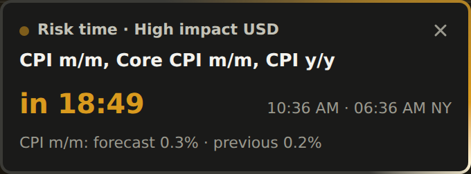

The same releases are drawn on every chart as dashed vertical lines with their
name at the top: amber for what's ahead (and the last 10 minutes), grey for what
already came out this week. Upcoming ones get label space first; switch them off
with **News** above the chart. Times are converted to the feed clock, so the
lines match the candles whatever that clock is.

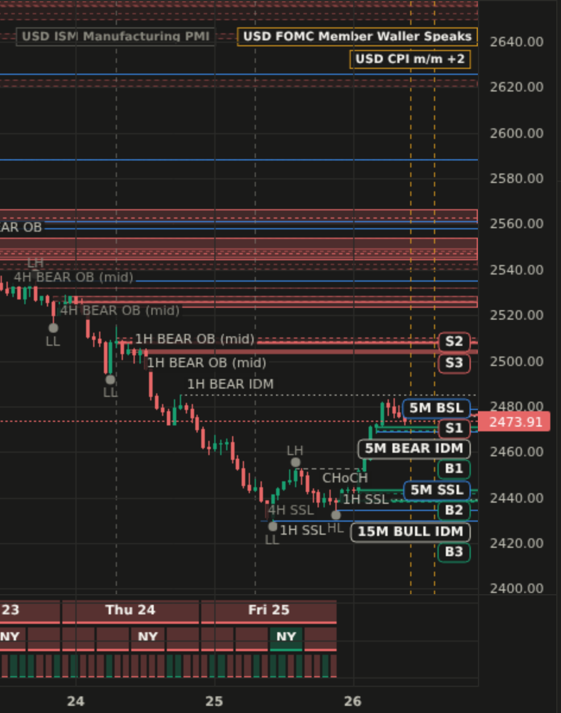

The calendar comes from ForexFactory's free weekly feed, fetched at most once an
hour and kept in the database. **Settings > News calendar** picks the currencies
and impact levels and lists what's coming this week.

### Past reactions to a release

Every fetched week stays in the database (`calendar_events`), so Wednesday
builds up a history of releases. For each event type (CPI m/m, NFP, FOMC
statement, …) it measures gold after past releases, from the M1 bars:

- the move 5, 15 and 60 minutes after, from the last price before the release,
  in price and in ATRs (ATR(14) of the 15M bars before it);
- the high-low range of the first 15 minutes;
- how often the first move reversed: the 60-minute move on the other side of the
  pre-release price from the 5-minute one;
- the median 15-minute move when the actual came in above or below the
  forecast, when the history has the actual figure (imported calendars can).

Only releases with M1 bars from just before to an hour after count (the most
recent 24 per event), and every figure says how many that was. The release's
UTC time is converted to the feed clock the same way as the news lines, so the
times line up whatever that clock is. These describe past moves; they don't say what the next
release will do.

They show in two places: a line on the risk-time card (*CPI m/m: median 15m
range 9.40 (last 12)*) and the tooltip when you hover a news line on the chart.

**Settings > News calendar > Past reactions** has the table, and **Import calendar
CSV** adds older weeks, since the feed only gives the current one. The CSV needs a
header with `currency` (or `country`), `title` (or `event`) and `datetime`, or
`date` and `time` (`8:30am` works); `impact`, `actual`, `forecast` and `previous`
are optional. Times without an offset are read as UTC or New York time, as
picked next to the button; all-day and tentative rows are skipped. Titles have to
match the feed's (`CPI m/m`, `Non-Farm Employment Change`) to count as the same
event. A release imported again is updated, and a figure the file has isn't
wiped by the weekly feed later.

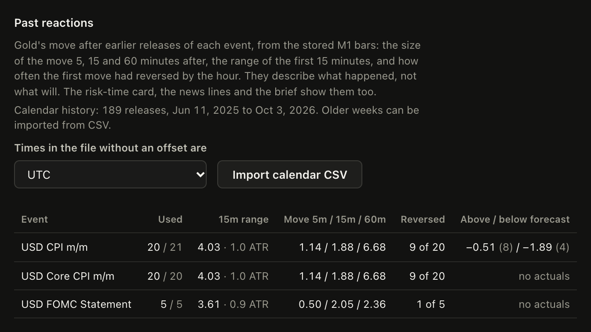

## Full screen and multiple charts

**On the chart page.** The layout button at the top right (next to the snapshot) splits the
chart page with the same layouts as full screen. The main chart always takes the first place,
left or top: it is the scanned market on the toolbar's timeframe, with the drawing tools, the
levels pane and the toolbar acting on it. The other charts have their own timeframe tabs, market
and layers, shared with full screen (chart 2 is chart 2 in both), and their lines can be dragged.
**One chart** goes back to a single chart. Bar replay and a phone show only the main chart.

The button at the bottom right of the chart (or **F**) opens the charts full
screen, TradingView style, without a page header: the bar at the top holds the drawing
tools, the layout, **Layers** (Mid OBs, HTF, Swings, News and the session levels for
every chart), **Indicators** and the layout snapshot, and **Exit** at its right end,
which always shows: on a narrow screen the tools scroll sideways instead. Pick a
layout from the layout menu:

- **one chart**, **two side by side**, **three columns** or **three rows**;
- **one big chart with two or three stacked beside it**, for an execution chart
  next to its higher timeframes;
- **four in a 2 × 2 grid**, or **six in 3 columns × 2 rows** for an ultrawide
  monitor.

Each chart has its own timeframe tabs; the first one follows the dashboard's
timeframe, the others are remembered in this browser, as is the layout. **Esc** or
**Exit** goes back. On a phone the charts stack and scroll.

- **Per-chart layers**: the layers button at the right of a chart's tabs gives
  that chart its own detectors, overlays, session levels and candle count (more candles for a 4H
  chart that should show weeks, fewer for a 1M one). It follows the toggles at the
  top until you change something in it; then a dot marks it, and **Reset to the
  toggles above** hands it back. Each chart's choices are remembered by its place
  (chart 1, chart 2 …), so they survive switching layouts as long as the layout
  still has that chart.
- **Linked crosshairs**: hovering one chart moves the crosshair of the others to
  the candle that contains the same moment on their timeframe (and the same
  price), and their OHLC and quarter readouts follow. A chart whose candles
  don't reach back that far just hides its crosshair.
- **Another market in a chart**: the menu next to a chart's timeframe tabs picks its
  market from the same list as the main chart (Settings > Markets), for
  example silver on the right next to gold on the left. That chart shows the other
  market's candles and live price from TradingView, labelled **Not scanned**: levels,
  setups, alerts and the bias belong to the scanned market. It can be drawn on: its
  drawings are kept for that market (with the same tools, but without alerts), and
  the selected drawing's style bar and the Delete and undo keys follow the chart you
  last clicked. Picking the scanned market brings the chart back. Each chart's market
  is remembered by its place. In bar replay every chart shows the scanned market.
- **Resizable panes**: drag a line between charts; each line moves only the two
  charts beside it. Arrow keys move a focused line (Shift for bigger steps), and
  double-click shares the two evenly. Every layout remembers its own sizes.

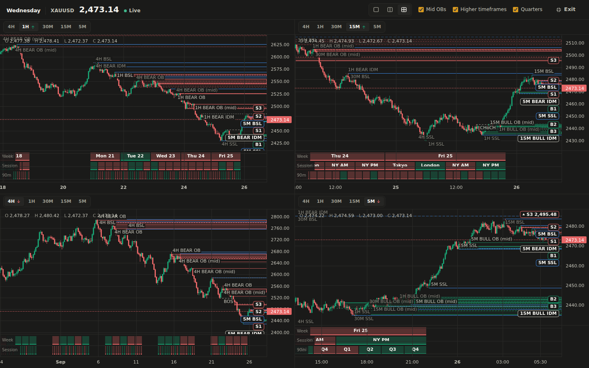

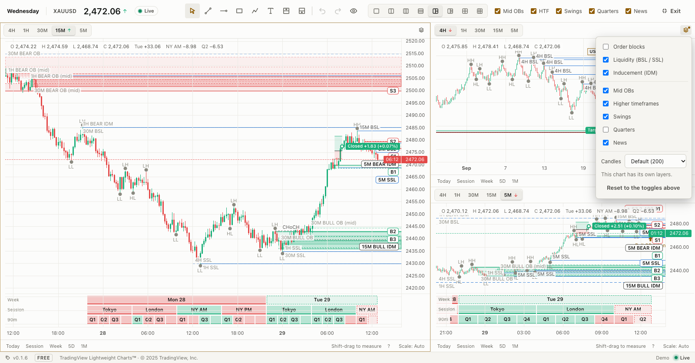

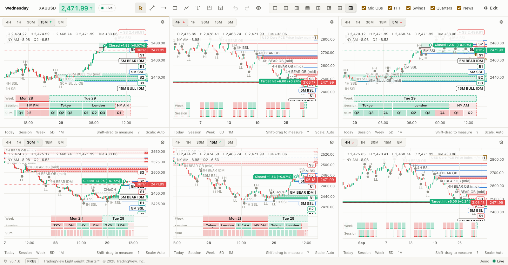

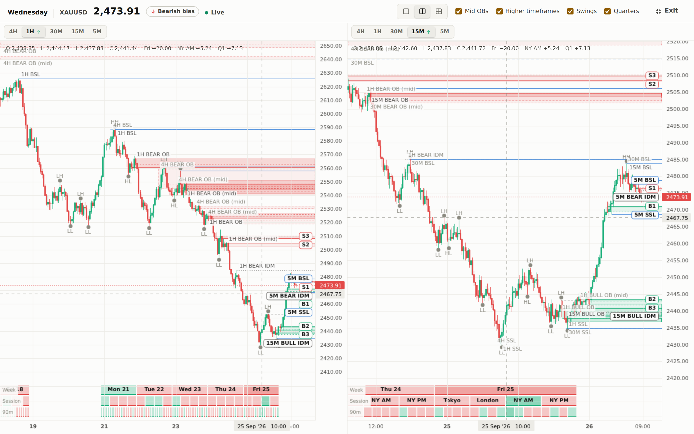

## Bar replay

With the right side of the chart in view, every order block looks obvious.
**Replay** (▶ in the chart's top bar, beside the link button) hides the future: it puts
the chart back at a past minute and plays the stored history forward, so you
decide candle by candle as you would have live.

- The clock starts a day back. Pick another time in the bar (on the feed's
  clock) and press **Go**.
- **‹** and **›** step one candle of the chart's timeframe, **+1m** one minute,
  and **Play** runs at 1, 10 or 60 minutes a second. Keys: Space plays or pauses,
  ← and → step a candle, and Shift steps a minute.
- Only bars that had closed by the clock are used. The scan runs on them exactly
  as it ran live, so the ladder, setups and structure are what you'd have seen
  then; the candle still forming at the clock is built from its minutes so far.
  Today's bias isn't applied to the past.
- The quarters pane, killzones, session levels and news lines
  come from the live data, so they're off during replay. Full screen and
  pop-out wait until you exit.
- The status reads **Replay** instead of Live. **Exit replay** returns to the live chart.

How far back it can go depends on the stored M1 history: as far back as the
screener has been running ([Storage](data-sources.md#storage)).

## Charts in their own windows

For a second or third monitor, a chart can open in a window of its own: the
**pop-out** button at the right end of the main chart's top bar (next to full screen),
or the same button at the right of a full screen chart's tabs. It opens that
timeframe, with the layers and session levels of the main window's toggles.

A popped-out chart is bare: timeframe tabs, the live price, the bias, the drawing
tools, a link button and the status bar (with the TradingView notice). No dock and
no rail. Every window reads the same local server, so it updates with the same
ticks and scans. A drawing made or changed in one window shows in the others at
once. In a browser it's a popup window (allow popups for the dashboard); in the
desktop app it's a native window that closes with the main one. Its address is
`#popout/5M` (with `/A` for a link group), so it can be bookmarked.

### Link groups

The link button (beside pop-out, and in a popped-out window's bar) puts a chart in
group **A**, **B** or **C**. Charts in the same group, in any window, follow each
other:

- the **crosshair** always: hovering one moves the others to the candle that
  holds the same moment on their timeframe;
- **scroll and zoom** (on by default): the same stretch of time, whatever the
  timeframe;
- **timeframe** (off by default): switching one switches the others.

The two options belong to the group, so they're the same in every window. An
unlinked chart doesn't follow anything. The charts inside full screen are already
linked with each other.

### Workspaces

**Workspace** in the chart's top bar saves the current setup under a name ("London
prep", "NY execution"): the chart layout (timeframe, full screen layout and pane
sizes, layer toggles, link groups) and, in the desktop app, every window with its
position, size, monitor and chart. Opening one puts the layout back, closes the
popped-out charts, opens the saved ones where they were, and reloads the
dashboard. **Update** saves over a workspace, and **Remove** deletes it. Up to 20
are kept, in the database, so clearing the browser's or the app's storage doesn't
lose them. In a browser, opening a workspace opens its charts as popups at their
saved positions (allow popups for the dashboard).

## Quarterly theory pane

Under the candles, a pane splits time the way quarterly theory does, in New
York hours with the trading day starting at 18:00 NY:

| Row | Blocks |
| --- | --- |
| Week | Mon (Q1), Tue (Q2), Wed (Q3), Thu (Q4), Fri |
| Session | Tokyo 18:00, London 00:00, NY AM 06:00, NY PM 12:00 (New York time) |
| 90m | each session in four 90-minute quarters, Q1–Q4 (hidden on 4H, too thin) |

A block is **green** when that period closed above its open and **red** when it
closed below. The running block is outlined only. To tell the quarters apart
instead, set **Colour blocks by** to **Quarter** in QT's settings (**Indicators**, the gear)
and pick a colour for each of Q1 to Q4 (Mon to Thu, Tokyo to NY PM, and the 90m
Q1 to Q4; Friday keeps the direction colours). The block's bottom edge still shows
the direction, green or red. Hovering the chart adds the
week, session and 90m move under the cursor to the readout at the top left.
Hide or remove the pane under **Indicators** (QT).

The **Quarters** panel below the chart counts how often each weekday, session and
90-minute quarter closed green, with the average move, over the stored history
(the running block excluded). The history grows as the screener keeps storing
bars, so the counts get more meaningful over time.

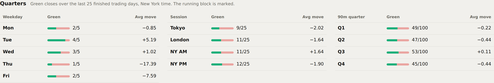

The blocks need to know what clock the bar times are in: see
[Feed clock](data-sources.md#feed-clock).

## Sessions and reference levels

The **Sessions** menu above the chart draws what an SMC trader marks by hand every
morning. Tick any of:

| Toggle | What it draws |
| --- | --- |
| Killzones | Faint bands: Asia 20:00–00:00, London 02:00–05:00, NY AM 07:00–10:00, NY PM 13:30–16:00 New York. Named at the bottom of the chart unless the quarter pane's Session row is showing |
| Asia high / low | The Asia killzone's range, from 20:00 to the day's close, once the window has closed |
| Previous day H / L | PDH / PDL across the next trading day |
| Previous week H / L | PWH / PWL across the next week |
| Previous month H / L | PMH / PML across the next month |
| Day, week and 00:00 opens | The 18:00 day open, the Sunday 18:00 week open and the midnight New York open (true day open) |
| Quarter open | The current 90-minute quarter's open (see the quarterly pane above) |

A high or low turns faint from the first closed bar that trades through it (it was
swept). The running period's levels are named above their start, with the price.
Past days keep their lines, so you can see how price treated them; the last 30
trading days are drawn.

Everything is set in New York time, with the trading day from 18:00 to 17:00, and
converted to the feed's clock the same way as the quarterly pane, so the bands and
lines stay put through the DST changes whatever the broker's clock. The levels come
from closed M1 bars only; the previous month reaches into the stored history when
the live window doesn't cover it, and a period gives levels only when the history
holds all of it.

In full screen, each chart's layer menu can switch these separately from the menu
at the top (see [Full screen and multiple charts](#full-screen-and-multiple-charts)).

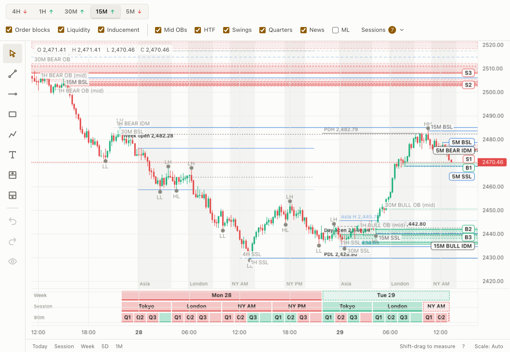

## Level ladder

Beside the chart, the **Levels** ladder lists what matters around price in the
same vertical order as the price axis:

- sell limit setups `S1`–`S3` (extreme first, then nearest) and the nearest
  liquidity and IDM above price,
- the live price,
- buy limit setups `B1`–`B3` and the levels below.

Every row is pinned on the chart under the same tag: setups as an entry line
with a dashed stop, levels as lines. Hovering a row highlights it on the chart
and dims the rest. A level outside the visible range docks to the chart edge
with its price. Clicking a row opens its timeframe.

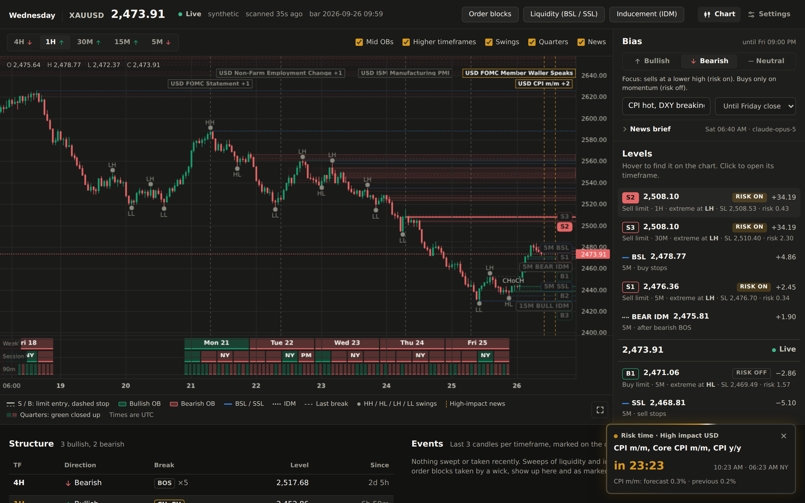

## Panels

The rail beside the chart keeps the bias on top (folded to its direction and expiry until you
click its heading; it stays as you leave it) and tabs under it:

- **Levels**: the ladder above.
- **Structure**: direction, last break (BOS / CHoCH, with the streak), its level and age, per timeframe.
- **Events**: levels swept or taken in the last few candles of each timeframe; the tab counts them.

Under the chart, a dock opens with its tabs (drag its top edge to resize, click
the open tab again to close it):

- **All timeframes**: the nearest level above and below per detector and timeframe.
- **Quarters**: how often each weekday, session and 90-minute quarter closed green.
- **Distribution**: how unusual the current move is (below).

### Move distribution

The **Distribution** tab puts the current day, week, session or 90-minute block
against the same periods in the past, as a histogram with the current one marked.

- **Measure**: the change in % (close to the previous close for a day or week,
  open to close for a session or block), the range (high minus low) in % of the
  open, or the range in daily ATR(14), taken from the 14 days *before* that day.
- **Lookback**: 1 year, 5 years or all the history there is. **Same weekday**
  compares a Wednesday only with Wednesdays; **Same session** compares NY AM only
  with NY AM (for 90-minute blocks, the same quarter of the same session).
- Periods follow New York time, like the quarters pane: the trading day starts
  18:00 New York the evening before, so boundaries stay put through DST whatever
  the feed's clock. Only closed periods are samples; the current one is the
  marker, "so far" while it runs.

The headline gives the **percentile** first ("−1.80% so far: lower than 97.1% of
252 days, about 1 in 34") and the z-score second. Gold's moves have fat tails:
big days happen more often than a normal curve says, so a z-score read as a
probability understates them, while the percentile just counts past periods. Tick
**Normal curve** to see the gap. Under 30 samples neither number is shown, only
the move and the sample count.

**Periods like this** lists up to 20 past periods that moved at least as far, and
what the next one did: facts about the history, not a forecast or advice.

History: the stored M1 bars and the live window. Days and weeks reach further back
with the feed's daily bars when it has them: TradingView's daily
history. The tables are rebuilt at
most every 6 hours; the current period updates with every scan.

## Light theme and mobile

The dashboard follows the system theme and works down to phone width.

<p>
  
  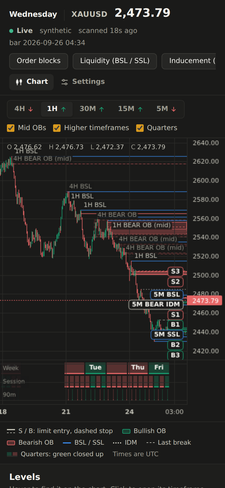
</p>

## Access

On `127.0.0.1` (the desktop app, `make serve`) the dashboard has no login. Served on
any other address (`--host 0.0.0.0`, Docker), or with `--login` / `XAU_LOGIN=1`, it
asks for a username and password, so you can use it from your PC and your laptop.
Write requests from another web site are refused either way, so a page open in the
same browser can't drive it.

**The first account.** On the first start with the login on and no account yet, the
server logs a one-time setup code (valid for an hour). Open the dashboard, choose
*Create account*, enter the code and pick a username and password (8 to 256
characters). Instead, you can set `XAU_AUTH_PASSWORD` in `.env` (an account named
`admin` is made from it on the first start), or run `wednesday-rs --create-user NAME`
(`wednesday --create-user NAME` from source), which also resets a forgotten password.

**Sessions.** A login lasts 30 days from the device's last use, in an HttpOnly cookie
(Secure behind HTTPS). After 10 wrong passwords in 15 minutes, the login waits. The
password is stored as an argon2id hash; the session token only as its SHA-256.

**A 24-hour preview.** Someone who opens the dashboard without logging in gets a preview: the
chart, the scan, the levels, the markets and the calendar work, and their drawings, drawing
templates, workspaces and layout stay in that browser. A banner shows when it ends, with *Log in*
and *Sign up*; closing it (×) leaves *Log in* at the top right of the toolbar, whose menu also
offers *Sign up*. After 24 hours the dashboard shows the login (one preview per address per 7 days,
so clearing the cookies doesn't restart it). Logging in moves what the browser kept into the
account.

**Sign up and Settings > Users.** *Sign up* makes an account that waits for the admin: it can't
log in until an admin approves it in **Settings > Users**, where they can also reject a sign-up,
disable an account, make it an admin or remove it. The first account is an admin; the last admin
can't be demoted or removed.

**Per account.** Each account keeps its own drawings, templates, workspaces, preferences and
journals, so they follow it to another device. The data source, markets, Telegram alerts, drawing
alerts, the bias, the news import, plugins and the licence are the server's: only an admin changes
them, and a user sees the data source read only. Data saved before the login was on belongs to
the first admin. Details: [design-guest-accounts.md](design-guest-accounts.md).

**The account menu.** Logged in, the toolbar's right end shows the account's initials; clicking
them opens its menu: the name and role, *Account and devices* (Settings > Login), *Users* for an
admin, and *Log out*, which goes back to the preview or the login. On `127.0.0.1`, with no
login, there is no account menu.

**Settings > Login** lists the devices logged in to the account, with *Log out* for
each, and changes the password, which logs every other device out.

Serve it over HTTPS (a reverse proxy) when it is reachable from outside, so the
password isn't sent in clear; see [deploy-docker.md](deploy-docker.md).
`--insecure` serves a network host without a login: anyone who reaches the port can
then change settings and delete data.

## UI development

```bash
make dev    # the Rust server on synthetic data on :8000 + Vite with hot reload on http://localhost:5173
```

The UI is React 19 + TypeScript + Vite with
[lightweight-charts](https://github.com/tradingview/lightweight-charts) in `web/`.
`make ui` rebuilds `web/dist`, which the server serves.
