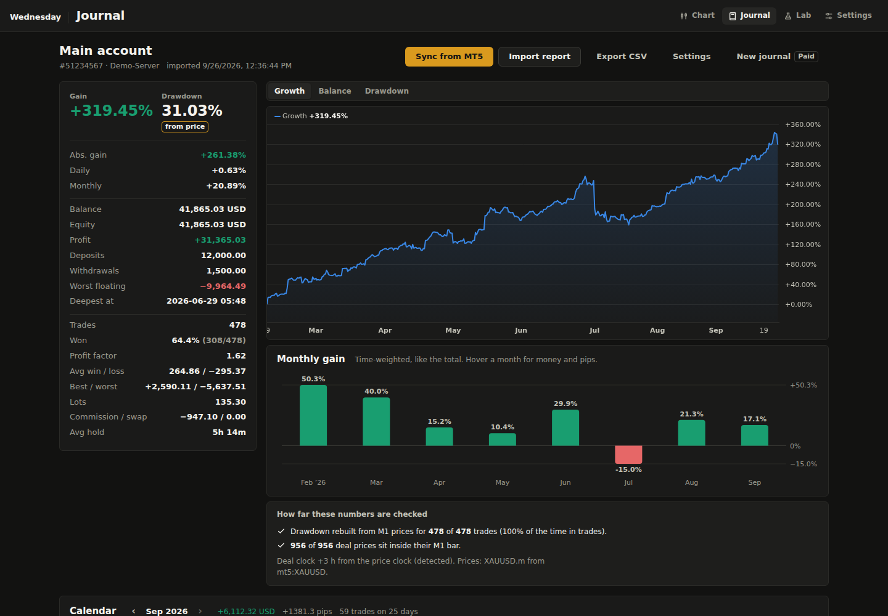
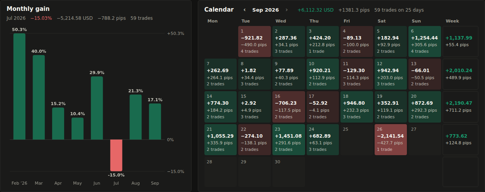
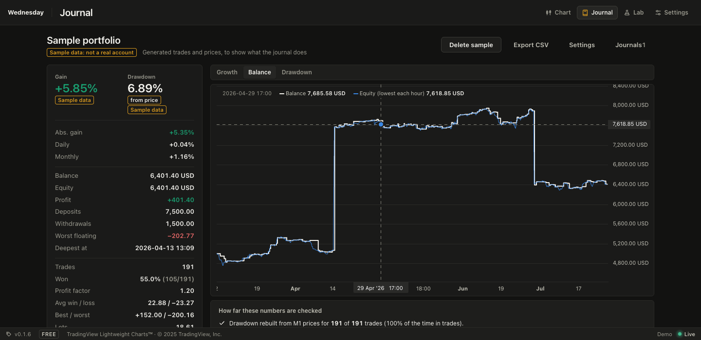

# Journal

The journal follows an MT5 account like a public track record (gain, drawdown,
deposits, the growth curve), but the drawdown can't be dressed up: it is rebuilt
from the price, minute by minute, instead of read off the closed results.

Open **Journal** in the top bar. It needs a database (the default SQLite one is fine).
One journal is free (a sample portfolio from an older version doesn't count); more than one (say, one
per account) needs the **Multiple journals** feature in your plan (Settings, Plan).

## The sample portfolio

Older versions made a **Sample portfolio** on first start: five months of made-up
XAUUSD trades, marked **Sample data: not a real account**. No account, strategy
or broker produced its numbers. It is no longer created, and the app can't bring
it back. A database from an older version may still hold it: it doesn't count as
a journal, takes no report, and **Delete…** next to it under Settings, Journal,
Journals removes it with its prices like any journal.

The screenshot on this page is of that sample, made by a generator with a fixed
seed (`journal/sample.py`) that the tests and the docs use. Its M1 bars are
stored under their own source `sample`, which the scanner, the chart and your own
journals never read.

## The header and Journal settings

The header holds the journal's name (a picker when there are several), one line
with the account, server and when its report was last imported ("Imported 2 min
ago", or "Not imported yet"), and a gear that opens
**Settings, Journal** (`#settings/journal`). Everything that sets up or manages a
journal lives there, saved field by field:

| Section | |
| --- | --- |
| This journal | Name; the MT5 account, server, company and currency from the last imported report. |
| Report | When the report was last imported; **Import report**. |
| Display | **Show Saturday and Sunday in the calendar**, off by default. |
| Advanced | **Broker time offset (hours)**: leave empty to detect it from the deal prices. |
| Data | **Export trades (CSV)**. |
| Journals | Every journal with its account and last import, **Open**, **Remove journal…**, and **New journal**. |

## Journals

A new journal takes a name and the MT5 account number (the digits of the login,
as MT5 shows it under *Navigator*, *Accounts*). It starts empty; its trades come
from that account's history report (see below). One account has one journal; a
second journal for the same number is refused.

Under **Journals** in Settings, Journal, the open one says *Current*. **Remove
journal…** asks first, then deletes its trades and notes from Wednesday and
changes nothing in MT5.

## Filling it

**Import report** in Settings, Journal. To make the report, in the MT5 terminal:
*History* tab, right click, *Report*, *HTML*, with *All history* selected. The
*Positions* table gives the trades, the *Deals* table the deposits and
withdrawals. Wednesday reads the account number, server, company and currency
from it; never a password or the account holder's name.

The report is a file you upload, so the dashboard doesn't have to run on the same
machine as MT5. Wednesday doesn't connect to the terminal or log in to the
broker, and never sees a password.

An import replaces the journal's trades, so export the full history each time.
A journal belongs to one account: a report of a different account is refused.
To bring the journal up to date, export and import the report again.

## The numbers

| | |
| --- | --- |
| Gain | Time-weighted: each closed trade grows the account by its result over the balance it was taken on, chained. A deposit isn't gain, a withdrawal isn't loss. |
| Abs. gain | Trading profit (with commission and swap) over everything deposited. |
| Daily, Monthly | The gain spread evenly over the days since the first deposit. |
| Drawdown | The deepest fall of the equity from its high, in the same time-weighted terms. See below. |
| Balance, Equity | Deposits, withdrawals and closed results; equity adds open trades at the last price. |
| Worst floating | The lowest the open trades were, together, in money. |

The numbers also include trades, win rate, profit factor, average win and loss, best and worst,
lots, commission, swap and the average hold. The trade list below is paged, newest first; click a trade for its note. **Export trades (CSV)**,
in Settings, Journal, gives every trade with its worst and best floating result,
whether it was checked, and your note.

Under the curve, one line says how the drawdown was worked out ("Drawdown from
closed results. Prices for 0 of 165 trades."), with **Details** for the full
check. Deal prices outside their bars show in red with what to do.

## Monthly gain and the calendar

Under the curve, side by side: **Monthly gain** draws each month's gain as a bar from zero, green up and red
down, time-weighted like the total (so a deposit mid-month doesn't inflate it).
The line above the bars shows the latest month's gain, money, pips and number of
trades; hover or tab to a month to show that one instead.

The **calendar** shows a month of closed trades per day, by the day they closed
on the broker's clock: the result in money and pips, and how many trades. The
tint is green or red by the sign and stronger for bigger days (scaled to the
month's biggest). The last column adds up the week. It shows Monday to Friday:
weekend results still count in the week and the month, and the week cell names
them ("incl. Sat +145.60"). **Show Saturday and Sunday in the calendar** in
Settings, Journal brings the two columns back. On a phone the money is rounded.

**Pips** follow the usual journal convention: 0.1 on gold (a 1.00 move is 10
pips), 0.01 on yen pairs and silver, 0.0001 on other currency pairs. A trade's
pips don't depend on its size.

## Drawdown from the price

A statement only shows closed results. A trade that sat 50 points under water
and closed green looks like no drawdown at all. The journal rebuilds the equity
instead:

1. For every minute a trade was open, its floating result at that M1 bar's worst
   price: the low for a buy, the high for a sell. The entry and exit minutes
   count from the deal price on, since the bar also holds prices from before the
   entry or after the exit.
2. The open trades' results are added up at each minute, on top of the balance
   at that moment. When a trade closes while another is open, the other one's
   floating result counts at that moment too, so banking a winner next to a
   losing trade isn't a new high.
3. Drawdown is the largest fall from the highest point before it, time-weighted
   so deposits and withdrawals don't move it.

The money per point comes from the trades themselves (profit over the price move
and lots), so nothing about the contract has to be set. Gold with no closed trade
to learn from uses 100 per lot.

The **Balance** tab draws the balance as a step line and the equity at its lowest
in each hour; the **Drawdown** tab draws the fall from the high over time.

## What is checked

The box under the chart says how far the numbers are checked:

- **Rebuilt from prices**: the trades with M1 bars for their whole life. The
  bars are the ones Wednesday stored while running (the `bars` table, timeframe `1m`), matched
  by symbol: `XAUUSD.m`, `XAUUSDm`, `XAUUSD#` and `GOLD` are all XAUUSD, and the
  stream with the most bars is used. Trades without bars count at their closed result, and the
  drawdown badge says **closed only** when none could be rebuilt.
- **Deal prices**: every entry and exit price has to sit inside its M1 bar (with
  0.03% to spare for the spread). A trade whose prices aren't in the market isn't
  used for the drawdown and is listed. That catches an edited report, or prices
  from a different feed than the bars.

The broker's deal clock and the price feed's clock can be hours apart. Unless
you set the offset (Broker time offset in Settings, Journal), the journal tries every
whole hour from −14 to +14 and uses the one where most deal prices fit their bars.
Bars from the same market as the account line up best: TradingView's
`FX:XAUUSD` is spot gold. Only the M1 bars the screener has stored count, so
trades from before it started running (see [Storage](data-sources.md#storage))
are counted at their closed result.

## Trades

The table lists closed time, symbol, side, result and pips first, then lots and
prices. **Worst** and **Checked** only show when a trade on the page has stored
prices, and **Note** when one has a note, tag or chart. On a phone the table keeps
the time, symbol, result and pips; the rest is in the opened row.

## Notes and reviews

Above the trades, **Notes and reviews** keeps what isn't a trade: a **note**
(what you see, what you're waiting for) or a **session review** (the plan, what
price did, what you did), with tags and a mood from 1 to 5. On the chart, the
book button beside a setup on the ladder (**Journal this**) adds that setup to
the open journal: its tag, timeframe, side, entry and stop.

Every entry keeps the market as it was when you wrote it: the price, your bias,
the nearest three setups each side, each timeframe's last break, and the next
high-impact releases. **Market then** under an entry shows it. It never changes
afterwards, so a review a week later sees what you saw, not today's scan.
Editing an entry changes its text, tags and mood only. Entries go with the
journal when it's removed.

## Notes

Click a trade, or Tab to its close time and press Enter, to write a note and tags
(`a+ setup`, `fomo`, `moved stop`); Escape closes it. They
are kept by trade, survive a re-import, and go into the CSV. They are the start of
what the second brain (#15) will read.

A trade can also hold chart pictures: under any chart, press the camera and
**Attach to a journal trade** (see [Chart snapshots](dashboard.md#chart-snapshots)).
They show above the note, open full size on a click, and the bin removes one. A
trade keeps up to 12; a camera and the count show in the Note column. The images
are PNG files in `data/snapshots/`, next to the database's `data/` folder and never
outside it; removing the picture or the journal deletes the files.

## Storage

`journals`, `journal_trades`, `journal_cash` and `journal_notes` in Wednesday's
database, and the chart pictures in `data/snapshots/`. A sample portfolio from an
older version keeps its bars in `bars` under the source `sample`. Times are unix seconds of the broker's server clock, as MT5 reports
them. Nothing leaves the machine.
